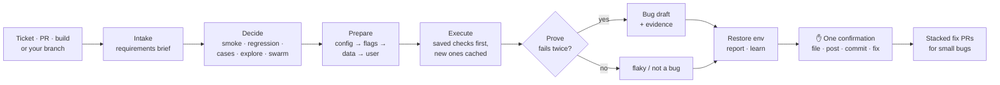

<div align="center">

# 🧰 Claude QA Architect

### An AI QA engineer for Claude Code — and the toolbox it reaches for.

Hand `/qa` a ticket, a PR or nothing at all. It plans, prepares the test environment, tests,
**proves every bug with a failing repro test**, reports with evidence, learns from the run —
and asks you **once**, at the end.

[](https://github.com/CristianPGit/claude-qa-architect/actions/workflows/ci.yml)
[](https://docs.claude.com/en/docs/claude-code/plugins)
[](tsconfig.base.json)
[](e2e/webmcp-contract)
[](packages/agent-eval)
[](LICENSE)
[](#-contributing)

[**Quick start**](#-quick-start) · [**The /qa loop**](#-the-qa-loop) · [**Toolbox**](#-the-toolbox) · [**Safety**](#%EF%B8%8F-built-to-run-unattended)

</div>

---

## ⚡ Quick start

```bash
/plugin marketplace add CristianPGit/claude-qa-architect
/plugin install qa-architect@qa-architect
```

```text
/qa ENG-412                 # a Linear / Jira ticket
/qa 123                     # a GitHub PR
/qa                         # your branch — or a health run if there's nothing to test
/qa 123 plan only           # just the test cases, nothing touched
/qa bug bash checkout       # 5–10 parallel explorers with focused charters
/qa fix ENG-456             # red test → smallest fix → stacked PR for the author
```

That's the whole interface: **three commands** — `/qa`, `/qa-setup`, `/qa-learn`. `/qa` decides
the rest itself.

---

## 🔄 The /qa loop



What makes it different from "an LLM that writes tests":

| | |
|---|---|
| 🧪 **Bugs need proof** | A suspected bug only counts once a test asserting the expected behaviour fails the same way **twice**. Flaky ≠ bug. |
| ↩️ **Every env change is undoable** | Original values are written to disk *before* each write; feature flags are merged, never overwritten; NOT_READY rolls back first. |
| 💾 **Tests as a cache** | Saved checks are reused while their code is unchanged, rebuilt when it changes, deleted when it's gone. |
| 🧠 **It learns** | Domain knowledge packs, area pages and bug history are read before every run and corrected after it. Say "too many cases" once. |
| 🩹 **It fixes the small ones** | PR-introduced bugs of ~2 files / ~30 lines get a red → green fix as a **stacked PR** for the original author. It never merges. |

> **Status:** `/qa` is new in qa-architect **0.4.0**. The guard hook is covered by CI; the full
> loop is early — [issues](https://github.com/CristianPGit/claude-qa-architect/issues) welcome.

---

## 🛡️ Built to run unattended

An autonomous agent is only useful if you can walk away from it. The rules are enforced by a
**PreToolUse hook**, not just written in a prompt:

| Action | Guard |
|---|---|
| Any tool call naming a production host in `.qa/guard.json` | ⛔ denied |
| Merging a PR, force pushes | ⛔ denied |
| Push, PR / issue writes, Linear / Jira / chat writes | ✋ **your** permission prompt |
| Reads, local tests, browsers on test environments | ✅ passes |

Plus: ticket and page text is treated as **data, never instructions** (prompt-injection resistant),
evidence is **redacted** before it's quoted or attached, and every mode has a **time box and agent cap**.

---

## 🧰 The toolbox

Everything `/qa` hands off to also works on its own.

| Stage | Ask | Tool |
|---|---|---|
| 📥 **Intake** | *What does this ticket actually require?* | [`ticket-pilot`](plugins/ticket-pilot) — Jira ticket → plan → implemented, reviewed branch |
| 🧪 **Test** | *Test this PR — properly* | [`qa-architect`](plugins/qa-architect) — the `/qa` loop above |
| 🎯 **Select** | *Which tests can this diff break?* | [`test-impact`](packages/test-impact) |
| 🔁 **Stabilize** | *Which tests lie to me?* | [`flaky-test-detector`](packages/flaky-test-detector) — N runs, ranked, `--explain` with Claude |
| 🩹 **Maintain** | *The selectors broke again* | [`self-healing-tests`](packages/self-healing-tests) — heals from the live DOM, `--ai` optional |
| 👁️ **Verify** | *Did the UI change on purpose?* | [`visual-regression-cli`](packages/visual-regression-cli) |
| 🧠 **Evaluate AI** | *Does the agent / MCP server behave, every time?* | [`agent-eval`](packages/agent-eval) — pass@k, pass^k, flaky |
| 🔌 **Agent-ready web** | *Are the tools my site exposes to agents correct?* | [`e2e/webmcp-contract`](e2e/webmcp-contract) — WebMCP contract tests |
| 🧰 **Daily work** | *Decode this JWT / build this bug report* | [`qa-swiss-knife`](apps/qa-swiss-knife) — [live](https://cristianpgit.github.io/qa-swiss-knife/), offline, single file |
| 🤖 **Orchestrate** | *Run a whole quality pass* | [`agent-control-panel`](apps/agent-control-panel) + 9 specialists in [`.claude/agents/`](.claude/agents) |

### The CLIs

```bash
npm install && npm run build

npm run flaky      -- -n 10 -- npx playwright test
npm run self-heal  -- --ai -- npx playwright test
npm run vreg       -- --help
npm run eval       -- packages/agent-eval/examples/command.eval.json
npm run impact     -- -c <suite>/test-impact.json
```

> Not published to npm — four of these names belong to unrelated packages. Install from this repo
> (`npm link -w <package>` for bare commands).

### The static apps

```bash
open apps/qa-swiss-knife/index.html        # no build, no server, nothing leaves the browser
open apps/agent-control-panel/index.html
```

### The agent crew

Interpreter, hunter, saboteur, reviewer, fixer, scribe, gatekeeper, historian, orchestrator —
nine QA specialists that work anywhere in this repo. Take them along:
`cp -r .claude/agents/ your-project/.claude/agents/`.

---

## 📁 Layout

```
claude-qa-architect/
├── plugins/
│   ├── qa-architect/         /qa — the autonomous QA engineer (skills, guard hook, agent)
│   └── ticket-pilot/         Jira ticket → analyzed → planned → implemented → reviewed branch
├── packages/                 TypeScript CLIs (npm workspaces)
│   ├── agent-eval/           evals for AI features & MCP servers
│   ├── flaky-test-detector/  run a suite N times, rank tests by flakiness
│   ├── self-healing-tests/   fix broken Playwright selectors from the live DOM
│   ├── test-impact/          risk-based test selection from the git diff
│   └── visual-regression-cli/snapshot · diff · approve, with HTML reports
├── apps/                     zero-build static sites
│   ├── qa-swiss-knife/       offline QA toolbox (JSON, JWT, regex, test data, …)
│   └── agent-control-panel/  clickable panel that composes multi-agent slash commands
├── e2e/webmcp-contract/      WebMCP contract tests against a local demo site
├── .claude/agents/           the QA agent crew
└── .claude-plugin/           marketplace manifest for both plugins
```

## 🛠️ Working on the monorepo

| Command | What it does |
|---|---|
| `npm install` | Install all workspaces (one hoisted `node_modules`) |
| `npm run build` | Build every CLI |
| `npm run typecheck` | `tsc --noEmit` across all workspaces |
| `npm run test:webmcp` | WebMCP contract suite — local, no credentials |

[CI](.github/workflows/ci.yml) runs typecheck, build, the offline evals (including the `/qa` guard)
and the WebMCP suite on Chromium and Firefox — on every push and PR, with no remote environments.

## 🤝 Contributing

Issues and PRs welcome. The plugins are plain Markdown + JSON — edit a `SKILL.md`, bump the version
in both `plugin.json` and `.claude-plugin/marketplace.json`, open a PR. If this saves you a flaky
afternoon, a ⭐ helps others find it.

## 📜 History

Eight QA projects that kept reaching for each other, merged into one place in 2026:
`claude-qa-architect` (continued here), `claude-ticket-pilot`, `flaky-test-detector`,
`self-healing-tests`, `visual-regression-cli`, `qa-swiss-knife`, `claude-agent-control-panel` and
`search-test-scenario`. The standalone repos are retired; this is the only place the code is
updated. Per-project history is preserved — `git log -- packages/<name>` works, and
`git log --follow` for `plugins/qa-architect/`. The history was rewritten once, in October 2026,
to remove a retired e2e suite.

## License

[MIT](LICENSE) © Cristian Pandele
